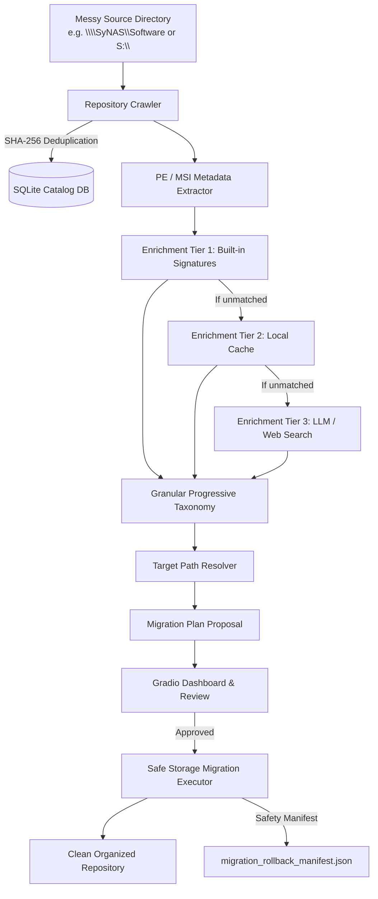

# 🗃️ Software Catalog Alchemist

[]()
[]()
[]()

> **Transform messy, uncurated installer archives (`.exe`, `.msi`, `.msp`) into clean, categorized, and deduplicated repositories with progressive taxonomy and rollback safety.**

---

## 📋 Overview

`SoftwareCatalogAlchemist` directly solves the classic IT storage challenge: an unstructured archive of legacy installer binaries buried deep inside an organic, messy directory tree (local drives or network shares such as `\\SyNAS\Software`).

By combining **SHA-256 chunked deduplication**, **PE/MSI static header inspection**, **3-tier deterministic & LLM-assisted enrichment**, and **granular progressive path resolution**, the system generates safe migration proposals before executing any changes on disk.



---

## ✨ Key Features

- **Chunked SHA-256 Deduplication**: Identifies identical binaries across nested directories and flags duplicates for safe deletion or skip.
- **Deep Static Inspection**: Extracts architecture (`x86`, `x64`, `ARM64`), vendor, product name, product version, digital signatures, and MSI Product Codes directly from PE/MSI headers without running the files.
- **Granular 10-Category Progressive Taxonomy**: Organizes software rationally into clean, progressive directory structures:
  - `01_Development_Tools` (`IDEs_and_Editors`, `Frameworks_and_SDKs`)
  - `02_Productivity_and_Office` (`Word_Processing`, `PDF_Tools`)
  - `03_System_Utilities` (`Backup_and_Recovery`, `OS_and_Boot_Media`)
  - `04_Drivers_and_Hardware` (`Drivers_and_Peripherals`)
  - `05_Media_and_Design` (`Photo_Editing`, `Video_Production`, `Audio_Production`)
  - `06_Security_and_Network` (`Anti-Malware_and_Cleaners`, `Network`)
  - `07_Scientific_and_Data` (`Data_Analysis`)
  - `08_Gaming_and_Entertainment` (`Game_Clients`)
  - `09_Internet_and_Communication` (`Web_Browsers`, `Communication`)
  - `10_Mobile_and_Devices` (`Android_Tools`)
  - `99_Unclassified_Orphan_Binaries` (Preserves source folder chain for manual inspection)
- **Portable Suite Recognition**: Automatically handles portable suites (e.g., `OperaPortable`) to prevent deep nested file fragmentation.
- **UNC & Local Path Support**: Handles local drives (`C:\`, `S:\CleanRepo`) and Windows UNC network paths (`\\SyNAS\Software\`).
- **Dry-Run & Rollback Manifests**: Every execution logs a complete rollback manifest (`migration_rollback_manifest.json`) enabling single-command rollback.
- **Interactive Web UI**: Built-in Gradio dashboard for pipeline scanning, plan review, execution, and JSON exporting.
- **YAML Scenario-Driven Testing**: Parametrized end-to-end and path resolution tests backed by `pytest` and YAML scenario files.

---

## 🏛️ Architecture & Project Structure

```
softwareCatalogAlchemist/
├── app.py                                # Unified Gradio Web Dashboard (Scan, View, Execute, Export)
├── backend/
│   ├── api/routes/                       # FastAPI routes (Catalog search, migration preview, execution)
│   └── catalog/
│       ├── models.py                     # SQLAlchemy database models (WAL mode & FTS5 search)
│       ├── orchestrator.py               # Main pipeline coordinator
│       ├── schemas.py                    # Pydantic schemas and contracts
│       ├── taxonomy.json                 # Canonical 10-category taxonomy definition
│       ├── taxonomy_service.py           # Taxonomy resolver and seeding engine
│       ├── enrichment/
│       │   ├── heuristic_matcher.py      # Tier 1 built-in signatures & local cache
│       │   └── llm_classifier.py         # Tier 3 LLM & web-assisted classifier
│       ├── organizer/
│       │   ├── executor.py               # Safe migration executor & rollback engine
│       │   └── path_resolver.py          # Progressive target path resolver
│       └── scanner/
│           ├── crawler.py                # Recursive directory walker & hash tracker
│           ├── msi_parser.py             # MSI database property extraction
│           └── pe_parser.py              # Windows PE header parser (VS_VERSION_INFO)
├── clean_software_catalog/
│   └── migration_plan.json               # Exported migration plan database snapshot
├── reports/                              # CodBot Architecture and Design Specifications
│   ├── TAD_softwareCatalogAlchemist.md   # Technical Architecture Document
│   ├── SDD_softwareCatalogAlchemist.md   # Software Design Document
│   ├── MDD_softwareCatalogAlchemist.md   # Module Design Document
│   ├── POC_softwareCatalogAlchemist.md   # Proof of Concept Report
│   └── implementation_plan_softwareCatalogAlchemist.md
├── tests/
│   └── catalog/
│       ├── conftest.py                   # Pytest fixtures and temporary DB setup
│       ├── test_golden_catalog.py        # End-to-end golden pipeline integration test
│       ├── test_yaml_path_scenarios.py   # Pytest runner for YAML path resolution scenarios
│       └── scenarios/
│           └── test_path_resolution_hierarchy.yaml # YAML scenario definitions
└── tools/                                # Standalone CLI automation scripts
    ├── scan.py                           # Headless pipeline scanner
    ├── execute.py                        # Headless migration plan executor
    ├── export_json.py                    # Database exporter to JSON
    ├── gradio_viewer.py                  # Standalone migration review table
    ├── removal-script.ps1                # PowerShell helper for empty directories cleanup
    └── removal-script.py                 # Python helper for cleaning orphaned folders
```

---

## 🚀 Quick Start

### 1. Installation

Clone the repository and install dependencies in your virtual environment:

```powershell
git clone https://github.com/titwan37/softwareCatalogAlchemist.git
cd softwareCatalogAlchemist

# Create and activate virtual environment
python -m venv .venv
.venv\Scripts\Activate.ps1

# Install required dependencies
python -m pip install -r requirements.txt
```

### 2. Launch the Web Dashboard

Start the unified interactive dashboard in your browser:

```powershell
python app.py
```

Open `http://127.0.0.1:7860` to access the four workflow tabs:
1. **1. Scanner**: Provide your source folder (`\\SyNAS\Software` or `S:\`) and target folder (`S:\CleanRepo`), then trigger the scan.
2. **2. Migration Viewer**: Review proposed actions (`MOVE`, `DELETE_DUPLICATE`, `SKIP_LOW_CONFIDENCE`) with interactive tables.
3. **3. Executor**: Execute the reorganization with automatic rollback manifest creation.
4. **4. JSON Export**: Export all records and proposed paths to `migration_plan.json`.

---

## 🛠️ CLI Tools & Automation

For headless servers or automated cron/scheduled runs, use the scripts located in the [`tools/`](file:///C:/Dev/softwareCatalogAlchemist/tools) directory:

### Run Full Scan
```powershell
python tools/scan.py "\\SyNAS\Software" "S:\CleanRepo"
```
*Scans the repository, deduplicates files, extracts PE/MSI metadata, determines progressive taxonomy paths, and saves migration plans to `software_catalog.db`.*

### Review Migration Plans
```powershell
python tools/gradio_viewer.py
```
*Launches a lightweight review interface displaying source vs. proposed target paths.*

### Export Database to JSON
```powershell
python tools/export_json.py clean_software_catalog/migration_plan.json
```
*Dumps the current migration proposals, actions, and status from SQLite to a formatted JSON document.*

### Execute Plan
```powershell
python tools/execute.py "S:\CleanRepo"
```
*Executes all approved migration plans, creates target directory trees, moves/copies binaries, and generates `migration_rollback_manifest.json`.*

---

## 🧪 Testing & Validation

The project follows test-driven development (TDD) using `pytest`.

### Run All Tests
```powershell
python -m pytest tests/catalog -v
```

### YAML-Driven Path Scenario Testing
The repository includes a dedicated YAML scenario runner [`test_yaml_path_scenarios.py`](file:///C:/Dev/softwareCatalogAlchemist/tests/catalog/test_yaml_path_scenarios.py) reading from [`test_path_resolution_hierarchy.yaml`](file:///C:/Dev/softwareCatalogAlchemist/tests/catalog/scenarios/test_path_resolution_hierarchy.yaml):

```powershell
python -m pytest tests/catalog/test_yaml_path_scenarios.py -v
```

#### Example Scenario Definition:
```yaml
- id: "opera_portable_autoupdate"
  description: "Multi-level path resolution for Opera Portable sub-binary under Web Browsers"
  source_root: "\\\\SyNAS\\Software"
  current_full_path: "\\\\SyNAS\\Software\\SoftwareTools\\Tools\\OperaPortable\\App\\Opera\\30.0.1835.88_1\\opera_autoupdate.exe"
  raw_metadata:
    pe_company_name: "Opera Software"
    pe_product_name: "Opera"
    pe_original_filename: "opera_autoupdate.exe"
    detected_version: "30.0.1835.88_1"
  classification:
    canonical_vendor: "Opera"
    canonical_product: "Opera"
    product_suite: "OperaPortable"
    primary_category: "Internet and Communication"
    subcategory: "Web_Browsers"
    confidence_score: 0.95
  expected:
    action_type: "MOVE"
    progressive_taxonomy: "09_Internet_and_Communication/Web_Browsers"
    target_relative_path: "09_Internet_and_Communication/Web_Browsers/Opera/Opera/30.0.1835.88_1/opera_autoupdate.exe"
    target_full_path: "\\\\SyNAS\\Software\\09_Internet_and_Communication\\Web_Browsers\\Opera\\Opera\\30.0.1835.88_1\\opera_autoupdate.exe"
```

---

## 🔒 Safety & Rollback Guarantee

- **Non-Destructive by Default**: Source files are only modified or deleted if explicitly approved and executed in migration plans.
- **Rollback Manifest**: During execution, [`StorageMigrationExecutor`](file:///C:/Dev/softwareCatalogAlchemist/backend/catalog/organizer/executor.py#L15) writes a cryptographic mapping of old path, new path, file hash, and operation timestamp to `migration_rollback_manifest.json`.
- **Atomic Operations**: Corrupt or inaccessible files are logged into `scan_errors_report.txt` and skipped rather than halting the process.

---

## 📚 Technical Documentation

For in-depth specifications and architectural decisions, refer to the [`reports/`](file:///C:/Dev/softwareCatalogAlchemist/reports) folder:
- **[TAD (Technical Architecture Document)](file:///C:/Dev/softwareCatalogAlchemist/reports/TAD_softwareCatalogAlchemist.md)**: System topology, subsystems, and technology stack.
- **[SDD (Software Design Document)](file:///C:/Dev/softwareCatalogAlchemist/reports/SDD_softwareCatalogAlchemist.md)**: Class specifications, signatures, and interfaces.
- **[Implementation Plan](file:///C:/Dev/softwareCatalogAlchemist/reports/implementation_plan_softwareCatalogAlchemist.md)**: Detailed phase-by-phase development and validation roadmap.
