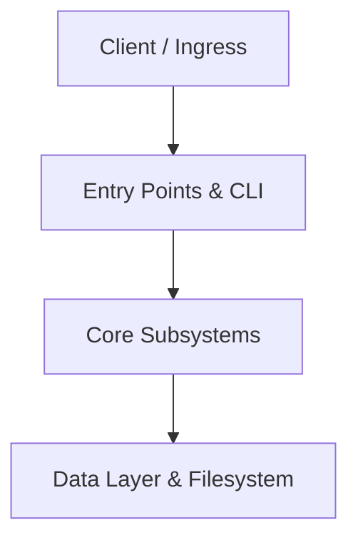

# Technical Architecture Document (TAD): softwareCatalogAlchemist
**Generated by CodBot 2.0 on 2026-10-25 00:18 UTC**
**Repository Root:** `C:\Dev\softwareCatalogAlchemist`

---

## 1. Executive Summary & Purpose
This Technical Architecture Document provides the structural specification for the `softwareCatalogAlchemist` repository.
The codebase consists of **25 tracked files** totaling **212 KB** across: **python**: 18 files, **unknown**: 4 files, **markdown**: 1 files, **javascript**: 1 files, **json**: 1 files.

## 2. High-Level Component Topology

## 3. Subsystem Breakdown
| Module / Subsystem | Scale | Functional Domain |
|---|---|---|
| `(root)` | 5 files | Core component subsystem |
| `backend` | 17 files | Core component subsystem |
| `frontend` | 1 files | Core component subsystem |
| `tests` | 2 files | Core component subsystem |

## 4. Execution Entry Points & CLI Surface
The primary executable anchors identified in the architecture:
- *(none detected)*

## 5. Technology Stack & External Dependencies
- **Primary Languages:** **python**: 18 files, **unknown**: 4 files, **markdown**: 1 files, **javascript**: 1 files, **json**: 1 files
- **Key External Dependencies & Modules:** `TaxonomyService`, `backend`, `contextlib`, `crawler`, `datetime`, `dotenv`, `enum`, `fastapi`, `hashlib`, `io`, `json`, `lucide-react`, `models`, `os`, `path_resolver`, `pathlib`, `pefile`, `pydantic`, `pytest`, `re`

## 6. Concurrency, Safety & Fault Tolerance
- **File Access Security:** Bounded read-only containment guarantees path traversal prevention.
- **Error Propagation:** Swallowed exceptions and bare except blocks audited by Multi-Agent Review.
- **State Management:** Session-scoped memory and cache isolation.
