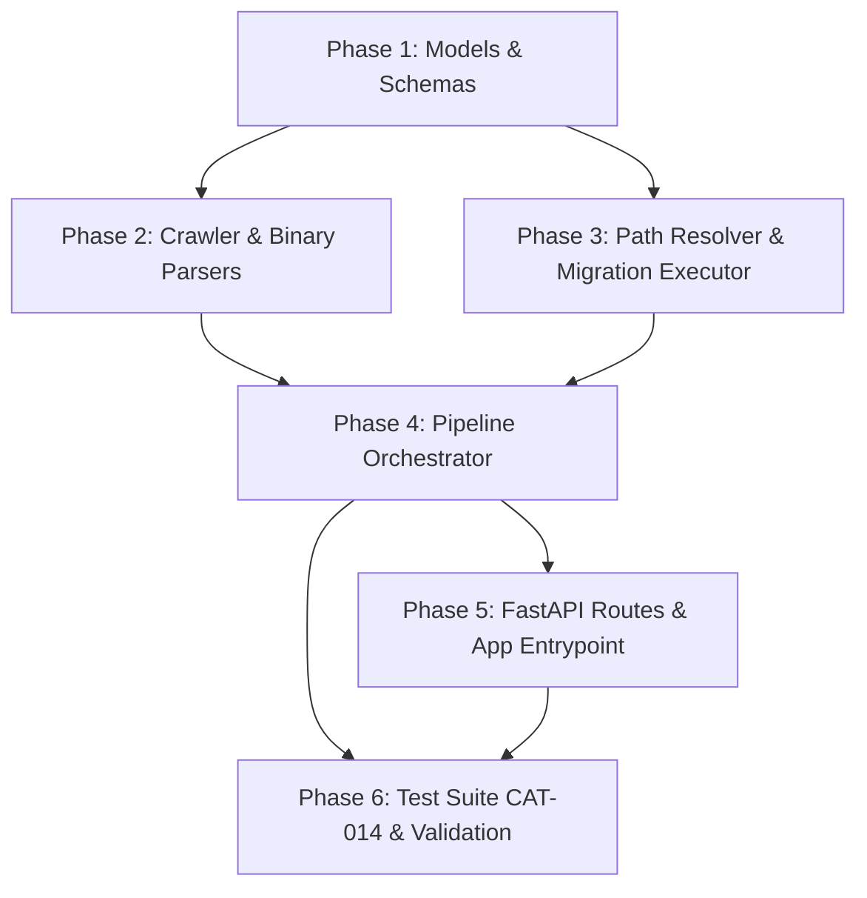

# Implementation Plan: Fix softwareCatalogAlchemist Issues & Achieve Full Documentation Conformance

**Project:** `softwareCatalogAlchemist` (`C:\Dev\softwareCatalogAlchemist`)  
**Target Specifications:**
- [POC_softwareCatalogAlchemist.md](file:///c:/Dev/softwareCatalogAlchemist/reports/POC_softwareCatalogAlchemist.md)
- [TAD_softwareCatalogAlchemist.md](file:///c:/Dev/softwareCatalogAlchemist/reports/TAD_softwareCatalogAlchemist.md)
- [SDD_softwareCatalogAlchemist.md](file:///c:/Dev/softwareCatalogAlchemist/reports/SDD_softwareCatalogAlchemist.md)

---

## 1. Objectives & Executive Overview

A systematic audit revealed that while all 20 classes and 39 interfaces specified in the SDD have been scaffolded across tasks `CAT-001` through `CAT-013`, multiple critical defects prevent the system from operating:
1. SQLite crashes on database initialization due to invalid secondary indexing on FTS5.
2. Pydantic validation rejects valid Windows paths (drive colons) and corrupts file extensions with extra trailing dots (`.exe.`).
3. Crawler has an undefined variable `file_path` (`NameError`) and broken SQL syntax.
4. Target Path Resolver accesses non-existent attributes on `BinaryAsset` and crashes unpacking database query results.
5. Storage Migration Executor does not record manifest entries, rendering rollback non-functional, and duplicates filenames in target paths.
6. Orchestrator does not persist `MigrationPlan` rows to the database and contains Python 3 `dict_keys` subscript errors.
7. FastAPI routes contain `NameError: name 'db' is not defined` and stubbed no-op migration endpoints.
8. Test suite `CAT-014` fails due to missing fixtures (`mock_file_assets`, `mock_classifications`).

This plan outlines a phased, surgical remediation to fix all issues, re-establish full architectural compliance, and bring the automated test suite to 100% pass rate.

---

## 2. Phase-by-Phase Implementation Plan

### Phase 1: Database Models & Schema Contract Corrections
**Files to update:**
- [`backend/catalog/models.py`](file:///c:/Dev/softwareCatalogAlchemist/backend/catalog/models.py)
- [`backend/catalog/schemas.py`](file:///c:/Dev/softwareCatalogAlchemist/backend/catalog/schemas.py)

**Tasks:**
1. **Fix FTS5 and SQLite WAL Initialization (`models.py`):**
   - In [`init_catalog_db()`](file:///c:/Dev/softwareCatalogAlchemist/backend/catalog/models.py#L99-L139), remove `CREATE INDEX idx_catalog_fts ON catalog_fts(rowid)` which causes `sqlite3.OperationalError: virtual tables may not be indexed`.
   - Realign `catalog_fts` virtual table schema with the POC specification:
     ```sql
     CREATE VIRTUAL TABLE IF NOT EXISTS catalog_fts USING fts5(
         canonical_vendor,
         canonical_name,
         summary_description,
         pe_original_filename,
         content='software_products',
         content_rowid='id'
     );
     ```
   - Add standard indexes specified in POC DDL:
     ```sql
     CREATE INDEX IF NOT EXISTS idx_assets_hash ON binary_assets(sha256_hash);
     CREATE INDEX IF NOT EXISTS idx_assets_product ON binary_assets(product_id);
     CREATE INDEX IF NOT EXISTS idx_locations_asset ON file_locations(asset_id);
     CREATE INDEX IF NOT EXISTS idx_migration_status ON migration_plans(status);
     ```
2. **Fix Pydantic Validators (`schemas.py`):**
   - Correct `RawBinaryMetadata.validate_extension`: ensure it guarantees a leading dot (e.g., `if not v.startswith('.'): return '.' + v`) instead of appending a trailing dot (`v + '.'`).
   - Correct `MigrationProposalContract.validate_path_characters`: allow Windows drive letter colons (`^[a-zA-Z]:[\\/]`) for `current_full_path`, while strictly enforcing illegal character restrictions (`*`, `?`, `"`, `<`, `>`, `|`) on relative and destination path segments.

---

### Phase 2: Crawler & Binary Parser Robustness
**Files to update:**
- [`backend/catalog/scanner/crawler.py`](file:///c:/Dev/softwareCatalogAlchemist/backend/catalog/scanner/crawler.py)
- [`backend/catalog/scanner/pe_parser.py`](file:///c:/Dev/softwareCatalogAlchemist/backend/catalog/scanner/pe_parser.py)
- [`backend/catalog/scanner/msi_parser.py`](file:///c:/Dev/softwareCatalogAlchemist/backend/catalog/scanner/msi_parser.py)

**Tasks:**
1. **Fix `RepositoryCrawler._handle_duplicate` (`crawler.py`):**
   - Update method signature to accept `file_path: Path`:
     ```python
     def _handle_duplicate(self, file_path: Path, file_hash: str, db_session: Session, root_dir: Path) -> Optional[int]:
     ```
   - Replace invalid string literal comparison `"binary_assets.sha256_hash" == file_hash` with proper SQLAlchemy ORM queries:
     ```python
     existing = db_session.query(BinaryAsset).filter(BinaryAsset.sha256_hash == file_hash).first()
     ```
   - When duplicate binary is found: register new [`FileLocation`](file:///c:/Dev/softwareCatalogAlchemist/backend/catalog/models.py#L64-L76) with `is_primary_copy = False`.
   - When new binary is discovered: insert [`BinaryAsset`](file:///c:/Dev/softwareCatalogAlchemist/backend/catalog/models.py#L42-L62) with file size, extension, and hash, then insert primary [`FileLocation`](file:///c:/Dev/softwareCatalogAlchemist/backend/catalog/models.py#L64-L76) with `is_primary_copy = True`.
2. **Ensure Non-Zero Hashes in Parsers (`pe_parser.py`, `msi_parser.py`):**
   - Compute real SHA-256 in `extract_pe_metadata` and `extract_msi_metadata` if not already set, avoiding `"0" * 64` placeholders.

---

### Phase 3: Path Resolver, Migration Executor & Rollback Engine
**Files to update:**
- [`backend/catalog/organizer/path_resolver.py`](file:///c:/Dev/softwareCatalogAlchemist/backend/catalog/organizer/path_resolver.py)
- [`backend/catalog/organizer/executor.py`](file:///c:/Dev/softwareCatalogAlchemist/backend/catalog/organizer/executor.py)

**Tasks:**
1. **Fix `TargetPathResolver` Attribute Queries & Query Unpacking (`path_resolver.py`):**
   - Fix line 94: check `product.confidence_score` (not `asset.confidence_score`).
   - Fix line 98: check `location.is_primary_copy` (not `asset.is_primary_copy`).
   - In `generate_migration_plans(db_session)`: query `FileLocation` joined with `BinaryAsset`, `SoftwareProduct`, and `Taxonomy`:
     ```python
     query = (
         db_session.query(FileLocation, BinaryAsset, SoftwareProduct, Taxonomy)
         .join(BinaryAsset, FileLocation.asset_id == BinaryAsset.id)
         .outerjoin(SoftwareProduct, BinaryAsset.product_id == SoftwareProduct.id)
         .outerjoin(Taxonomy, SoftwareProduct.taxonomy_id == Taxonomy.id)
     )
     ```
   - Correctly unpack `(location, asset, product, taxonomy)` and pass actual location path:
     - If `not location.is_primary_copy`: `action_type = ActionTypeEnum.DELETE_DUPLICATE`.
     - If `product is None` or `product.confidence_score < 0.70`: route to `99_Unclassified_Orphan_Binaries/{location.parent_folder_chain}/{location.current_filename}` with `ActionTypeEnum.SKIP_LOW_CONFIDENCE`.
     - If valid: route to `{category_prefix}_{category_name}/{subcategory_name}/{vendor}/{product}/{version}/{clean_filename}` with `ActionTypeEnum.MOVE`.
2. **Fix `StorageMigrationExecutor` Execution & Rollback (`executor.py`):**
   - Initialize `self._rollback_manifest_path = "migration_rollback_manifest.json"` in `__init__`.
   - Correct target path computation: `proposed_relative_path` already contains the clean filename. Use `dest_path = Path(target_root) / plan.proposed_relative_path`.
   - In `execute_plan`: populate `manifest_entries` with `{location_id, source_path, dest_path, sha256, timestamp}` for every moved/copied file and write to `migration_rollback_manifest.json`.
   - In `rollback_migration`: read the manifest and restore files to their exact `source_path`, remove newly created empty directories in `target_root`, and update `plan.status = MigrationStatusEnum.ROLLED_BACK.value`.

---

### Phase 4: Pipeline Orchestration & End-to-End Workflow
**Files to update:**
- [`backend/catalog/orchestrator.py`](file:///c:/Dev/softwareCatalogAlchemist/backend/catalog/orchestrator.py)

**Tasks:**
1. **Integrate `TaxonomyService`:**
   - In `_seed_taxonomies(db_session)`, call `TaxonomyService().seed_default_taxonomies(db_session)` rather than an ad-hoc single SQL statement.
2. **Fix Asset & Product Association:**
   - After running parsers and `HeuristicMatcher` / `LLMSoftwareClassifier`, look up or create the `SoftwareProduct` row and link `binary_asset.product_id = product.id`.
3. **Persist `MigrationPlan` Records to Database:**
   - Run `self.path_resolver.generate_migration_plans(db_session)`.
   - For each proposal, insert or update `MigrationPlan(location_id=proposal.location_id, proposed_relative_path=proposal.proposed_relative_path, action_type=proposal.action_type.value, status="pending")`.
   - Commit changes to `db_session`.
4. **Fix Dict Keys Subscripting:**
   - Remove `file_assets.keys()[list(file_assets.values()).index(asset_id)]` and use direct key/value lookups.

---

### Phase 5: FastAPI Routes & Application Entry Point
**Files to update / create:**
- [`backend/api/routes/software_catalog.py`](file:///c:/Dev/softwareCatalogAlchemist/backend/api/routes/software_catalog.py)
- Create `backend/main.py` (API ingress entry point)

**Tasks:**
1. **Fix Route Implementation (`software_catalog.py`):**
   - Fix `db` variable name to `db_session` in `search_catalog`.
   - Connect `/migration/execute` and `/migration/rollback` endpoints to `StorageMigrationExecutor` methods rather than returning mock comments.
   - Fix attribute access in `/migration/preview`: query `FileLocation.current_full_path` via `asset.file_locations`.
2. **Create Top-Level App Entry Point (`backend/main.py`):**
   - Instantiate FastAPI application, attach CORS middleware, and mount `/api/v1/catalog` router.

---

### Phase 6: Test Suite (CAT-014) Completion & Validation
**Files to update:**
- [`tests/catalog/conftest.py`](file:///c:/Dev/softwareCatalogAlchemist/tests/catalog/conftest.py)
- [`tests/catalog/test_golden_catalog.py`](file:///c:/Dev/softwareCatalogAlchemist/tests/catalog/test_golden_catalog.py)
- [`tasks/tasks.json`](file:///c:/Dev/softwareCatalogAlchemist/tasks/tasks.json)

**Tasks:**
1. **Implement Missing Fixtures in `conftest.py`:**
   - Add `mock_file_assets`: dictionary mapping synthetic file paths to asset IDs.
   - Add `mock_classifications`: dictionary mapping tier IDs to `LLMClassificationResult` objects (e.g. 7-Zip, Visual Studio, Unknown Orphan).
2. **Enhance `test_golden_catalog.py`:**
   - Write end-to-end tests validating:
     1. Recursive crawling and duplicate detection.
     2. Static PE/MSI metadata extraction and high-confidence classification.
     3. Low-confidence routing to `99_Unclassified_Orphan_Binaries`.
     4. Execution of file reorganization into `target_root`.
     5. Rollback restoring files back to `source_root`.
3. **Execute Test Verification:**
   - Run `python -m pytest tests/catalog/test_golden_catalog.py -v`.
   - Ensure all tests pass.
   - Update `tasks/tasks.json` marking `CAT-014` as `completed`.

---

## 3. Verification Commands & Validation Gates

At each phase, correctness will be verified using deterministic CLI commands:

| Phase | Validation Command | Success Criteria |
| :--- | :--- | :--- |
| **Phase 1** | `python -c "from sqlalchemy import create_engine; from backend.catalog.models import init_catalog_db; init_catalog_db(create_engine('sqlite:///:memory:')); print('Models & FTS5 OK')"` | Exits 0, FTS5 virtual table created without indexing error |
| **Phase 1** | `python -c "from backend.catalog.schemas import RawBinaryMetadata, MigrationProposalContract, ArchitectureEnum, ActionTypeEnum; m = MigrationProposalContract(location_id=1, current_full_path='C:\\test\\file.exe', proposed_relative_path='01_Tools/test.exe', action_type=ActionTypeEnum.MOVE, confidence_score=0.9); print('Schemas OK')"` | Exits 0, accepts Windows drive path without error |
| **Phase 2** | `python -c "from backend.catalog.scanner.crawler import RepositoryCrawler; from backend.catalog.scanner.pe_parser import extract_pe_metadata; print('Scanner OK')"` | Exits 0, crawler and parsers import and run |
| **Phase 3** | `python -c "from backend.catalog.organizer.path_resolver import TargetPathResolver; from backend.catalog.organizer.executor import StorageMigrationExecutor; print('Organizer OK')"` | Exits 0, classes initialize |
| **Phase 4** | `python -c "from backend.catalog.orchestrator import SoftwareCatalogOrchestrator; orch = SoftwareCatalogOrchestrator(); print('Orchestrator OK')"` | Exits 0 |
| **Phase 5** | `python -c "from backend.api.routes.software_catalog import router; print('Routes OK')"` | Exits 0 |
| **Phase 6** | `python -m pytest tests -v` | All tests pass (0 failures, 0 errors) |

---

## 4. Dependencies & Execution Sequencing



---

## 5. Next Steps
Following the `/plan` workflow, **no production code has been modified yet**. Please review this implementation plan and let me know if you approve or if you would like any adjustments before we proceed with Phase 1.
